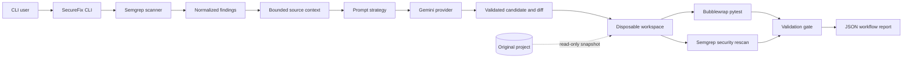
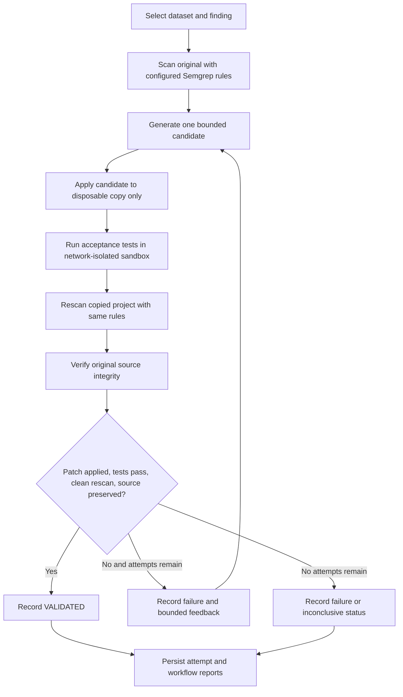

# SecureFix AI

## Problem statement and overview

Security scanners identify suspicious code but do not by themselves establish whether a candidate repair preserves behavior or addresses the finding. SecureFix AI combines Semgrep detection with Gemini-generated repair candidates and project acceptance tests plus a security rescan. Candidate code is tested only in an isolated copy; the original source is never automatically modified.

The project is a research/demo workflow, not an autonomous production remediation service. LLM output is untrusted, and a `VALIDATED` result means only that the configured patch, test, rescan, and integrity gates passed.

## Architecture

```text
src/securefix/
├── main.py                 CLI orchestration and JSON report generation
├── config.py               Default scan and context settings
├── sanitization.py         Redaction for report text
├── analysis/
│   └── repair_analyzer.py  Prompt orchestration and response validation
├── llm/
│   ├── gemini_provider.py  Isolated Gemini API adapter
│   └── prompts.py          Basic, structured, and context-feedback prompts
├── verification/
│   ├── isolated_workspace.py  Disposable project copy and candidate application
│   ├── sandbox.py             Bubblewrap sandbox for test execution
│   ├── test_runner.py         Bounded pytest execution
│   ├── security_rescan.py     Before/after Semgrep comparison
│   ├── workflow.py            Bounded repair and validation workflow
│   └── evaluation.py          Strategy metrics and reports
├── scanner/
│   └── semgrep_scanner.py  Safe Semgrep subprocess integration
├── detection/
│   └── finding_parser.py   Semgrep JSON to normalized findings
├── context/
│   └── code_context.py     Bounded, read-only source context
├── models/
│   ├── finding.py          Finding data model and serialization
│   └── repair.py           Validated structured repair proposal
└── patching/
    └── patch_manager.py    Path/range validation and reviewable diffs
```

Tests mock Semgrep and Gemini responses. `datasets/phase3/` contains five deliberately vulnerable benchmark examples and post-repair acceptance tests. `examples/` contains a separate harmless scan target; `reports/` is the default output directory. The source layout is packaged with `pyproject.toml`.

### Architecture diagram



### Repair workflow diagram



## Technology stack

- Python package and CLI, with pytest tests.
- Semgrep CLI for static analysis and JSON findings.
- Gemini via the official `google-genai` SDK for repair proposals.
- Git-based source snapshots and unified candidate diffs.
- Bubblewrap on Linux for isolated, network-disabled candidate test execution.

## Prerequisites and installation

- Python 3.10 or newer
- Semgrep CLI (required to run a real scan)
- Bubblewrap (`bwrap`) with working user and network namespaces on Linux (required for `run`)
- pytest (for tests)

Install the project and tests:

```bash
python -m pip install -e ".[dev,llm]"
```

The `llm` extra installs the official Gemini SDK (`google-genai`) and `python-dotenv`. Semgrep is a separate CLI dependency; install it using its [official installation instructions](https://semgrep.dev/docs/getting-started/):

```bash
python -m pip install semgrep
semgrep --version
```

Install Bubblewrap on Debian or Ubuntu:

```bash
sudo apt-get install bubblewrap
bwrap --version
```

SecureFix refuses to run candidate tests if Bubblewrap is missing or namespaces cannot be created. The validation command requires Semgrep, Bubblewrap, Gemini API access, and pytest within the isolated candidate copy.

## Streamlit web interface

The SecureFix AI dashboard is a thin interface over the existing `securefix.main`
CLI. It uses the same Semgrep scan and isolated repair/verification workflow; it
does not implement a separate repair path or apply candidates to uploaded source.

Install the web interface and the Gemini provider:

```bash
python -m pip install -e ".[web,llm]"
python -m pip install semgrep
```

For repair validation, Bubblewrap must also be installed and able to create its
required namespaces. Configure `GEMINI_API_KEY` on the server in the environment
or in the existing local `.env` file. The interface does not display the key.

From the repository root, launch the application with:

```bash
python -m streamlit run app.py
```

Open the local URL printed by Streamlit (normally `http://localhost:8501`).

### Upload, scan, and repair

1. Select **Source Code Analysis** and upload a ZIP archive of the project.
   The interface displays the validated file structure before running anything.
2. Select one or more listed Semgrep configurations. The interface offers
   fixed registry rulesets and the repository's checked-in, narrowly scoped SQL
   injection rule. Uploaded Semgrep rules and arbitrary command-line input are
   not accepted.
3. Choose **Scan Only** to use `securefix.main scan`, or acknowledge the
   hosted-model data notice and select **Run Scan and Repair** to invoke
   `securefix.main run`.
4. For repair, select the Basic, Structured, or Context Feedback strategy and
   choose a bounded attempt count from 1 to 10 (the backend's supported limit).
5. Review **Vulnerability Results**, **AI Repair**, and **Verification**. The
   **Reports** page lists saved JSON reports and any generated candidate diffs.

Dashboard totals are calculated from report files that actually exist in
`reports/`. Scan-only runs and repair workflows are counted separately.
Finding totals count finding records in saved scan and workflow reports; they
are not deduplicated into unique vulnerabilities. Validated, blocked, failed,
incomplete, and unknown workflow outcomes are classified separately. Uploaded
source is extracted into a temporary directory and removed after the CLI
finishes. SecureFix records reports under `reports/streamlit/`; generated
reports and patches remain available until removed by the repository operator.

### Interpreting results and security limitations

- Semgrep findings are static-analysis detections, not confirmation that a
  vulnerability is exploitable. Assess reachability, attacker control, and
  runtime behavior separately.
- **VALIDATED** means the configured patch, test, rescan, and original-source
  integrity checks passed. It is not a guarantee that the application is
  vulnerability-free. **BLOCKED** means required inputs or prerequisites
  prevented validation. **FAILED** means a candidate or configured check did
  not pass.
- Repair sends the finding and bounded source context to the configured Gemini
  service. Do not upload code that your organization does not permit sending to
  that provider.
- ZIP files are limited to 50 MiB, 2,000 files, 20 MiB per file, and 100 MiB
  expanded content. Traversal paths, links, special files, high compression
  ratios, encrypted entries, and unsupported file types are rejected.
- Scanning is read-only. Repair candidates are applied only in SecureFix's
  disposable workspace and test execution remains subject to the existing
  Bubblewrap sandbox. The interface never executes uploaded code directly on
  the host or weakens the backend sandbox. Bubblewrap is not a guarantee against
  every kernel or sandbox escape.
- The dashboard is intended for a trusted local environment. It does not add
  authentication or multi-user authorization; do not expose the Streamlit
  server to an untrusted network. Reports contain code-related evidence and
  should be handled as sensitive data.

The scanner checks for the `semgrep` executable at runtime. If it is missing, SecureFix prints installation instructions and exits without creating a report. The default Semgrep configuration is `auto`, which may require network access. SecureFix explicitly disables Semgrep metrics; Semgrep 1.183.0 rejects `auto` when metrics are disabled. In that environment, pass an explicit ruleset (for example, `--config p/security-audit`, which was verified here) or a local rules file. Do not enable metrics implicitly to work around that Semgrep restriction.

## Gemini provider configuration

Create a Gemini API key in Google AI Studio. Set it in the environment or put it in a local `.env` file in the working directory:

```dotenv
GEMINI_API_KEY=your-key
GEMINI_MODEL=gemini-3.5-flash-lite
```

`.env` is ignored by Git. Never commit or share the key. `GEMINI_API_KEY` is required; `GEMINI_MODEL` is optional and defaults to [`gemini-3.5-flash-lite`](https://ai.google.dev/gemini-api/docs/models/gemini-3.5-flash-lite), currently listed as stable and optimized for low latency and high-throughput tasks. You can override the model per repair command with `--model`. The request timeout defaults to 90 seconds and can be changed with `--llm-timeout`. The selected model must be enabled for the API key and available to your account. SecureFix does not verify account access or API connectivity until a request is made.

The Gemini adapter is isolated in `llm/gemini_provider.py`. Provider errors are classified (invalid key, permission, missing model, quota, rate limit, connectivity, timeout, temporary service unavailability, or other API error) and include sanitized diagnostics; API keys are redacted. Gemini responses are required to be JSON and are strictly validated before a candidate is built. No API credentials are written to scan reports or proposal files.

Check live API access with one small text-generation request before running a repair:

```bash
python -m securefix.llm.connectivity
```

The command reports success only after Gemini returns text; otherwise it prints the sanitized provider diagnostic and exits nonzero.

## Usage

```bash
python -m securefix.main scan ./examples
```

By default, the report is written to `reports/securefix-report.json`. Options:

```text
python -m securefix.main scan TARGET
  --output PATH          Report path (default: reports/securefix-report.json)
  --config CONFIG        Semgrep config (default: auto; repeat to combine configs)
  --timeout SECONDS      Scanner timeout (default: 120)
  --context-lines COUNT  Lines before and after each finding (default: 5)
```

For example, the isolated `run` command defaults to `p/security-audit` and can include local rules with repeated options:

```bash
python -m securefix.main run ./target \
  --config p/security-audit \
  --config ./rules/custom.yml
```

The same repeated `--config` syntax is supported by `scan`, `repair`, and `evaluate`. Existing single-config usage remains valid.

The CLI validates the target directory, runs Semgrep without a shell, adds context for source files within the target (including paths relative to the process working directory), writes the report, and prints a findings summary. Scanner errors, invalid paths, malformed results, and context read errors are reported explicitly. Report destinations with source-code file extensions are rejected to prevent accidentally overwriting source code. No source file is modified or executed.

## Phase 2 repair proposals

A repair command scans the target first, or reuses a Phase 1 report that belongs to the same target. It selects one finding by its 1-based index, refreshes bounded context, asks Gemini for a structured proposal, validates the response and each source range, and saves proposal JSON and a unified diff outside the scanned directory. The CLI displays the analysis and diff; it does not apply the patch.

```bash
# Basic prompt strategy
python -m securefix.main repair ./examples --strategy basic

# Structured prompt strategy (default)
python -m securefix.main repair ./examples --strategy structured

# Context + feedback strategy; feedback is optional input, not an automatic retry
python -m securefix.main repair ./examples --strategy context_feedback \
  --previous-repair "Prior candidate text" \
  --validation-failure "Describe an observed validation failure"

# Reuse a report and choose the second finding
python -m securefix.main repair ./examples --report reports/securefix-report.json \
  --finding-index 2 --strategy structured
```

`--output` selects the proposal JSON path and `--diff-output` selects the `.diff` or `.patch` path. Without `--output`, a timestamped JSON file is created under `reports/`; the diff is written alongside it. Output files must be outside the scanned target and existing outputs are never overwritten.

### Prompt strategies

- **basic**: finding and relevant code, with a request for grounded analysis and a minimal candidate repair.
- **structured**: adds explicit security constraints, expected behavior, exact line ranges, and preservation of unrelated functionality.
- **context_feedback**: adds optional previous proposal and validation-failure text to inform one new generation. It does not implement retries or claim that validation ran.

All strategies use the same validated JSON response format. Input code and feedback are treated as untrusted data. The analysis is instructed to distinguish evidence from assumptions and to describe potential attacker actions only at a high level when supported by the evidence.

### Proposal response format

```json
{
  "vulnerability_id": "python.security.example",
  "analysis": {
    "vulnerability_type": "unsafe evaluation",
    "explanation": "The shown call evaluates the supplied value. This is a finding from the supplied code; whether the value is attacker-controlled is an assumption.",
    "security_impact": "If an untrusted caller can control the value, unintended code execution may be possible.",
    "assumptions": ["The value may be influenced by an external caller."]
  },
  "repair": {
    "summary": "Use a restricted conversion for the expected input type.",
    "file_path": "app.py",
    "changes": [
      {
        "start_line": 10,
        "end_line": 10,
        "original_code": "    eval(value)",
        "replacement_code": "    int(value)"
      }
    ]
  },
  "reasoning_summary": "Restricts processing to the expected input type.",
  "limitations": ["Review callers and expected input formats."]
}
```

The schema is validated with typed Python dataclasses and strict JSON parsing. The patch manager additionally requires an exact target-relative file path, an in-target regular source file, non-overlapping in-context line ranges, and original lines that still match the source. It rejects malformed, stale, out-of-range, traversal, or unrelated-file patches. The generated JSON contains the proposal and candidate unified diff; a separate diff file is saved for review. Review the diff and proposal manually before applying any changes.

Hosted Gemini receives the finding and its bounded surrounding source context. Do not use this feature with code that your organization does not permit sending to the configured hosted provider. Common secret patterns are redacted before context is sent, but detection is best-effort.

## Phase 3: isolated validation and strategy evaluation

The `run` command scans the original project, selects a finding, generates a candidate, and applies it only to a disposable copy. It runs that copy's pytest suite in Bubblewrap with the host filesystem read-only, no network, a sanitized environment, timeouts, output caps, and resource limits. It then rescans the copy with Semgrep and records original-source integrity. Each attempt gets a separate JSON report; successfully generated candidates also get separate JSON and diff artifacts. The original scan is preserved, and the original source tree is never used as the writable test workspace.

```bash
# One bounded validation run (default strategy: structured)
python -m securefix.main run ./datasets/phase3/sql_injection \
  --strategy structured \
  --max-attempts 3

# Select one of the independently callable strategies
python -m securefix.main run ./datasets/phase3/sql_injection --strategy basic
python -m securefix.main run ./datasets/phase3/sql_injection --strategy context_feedback

# Run a reviewed, selected evaluation dataset (makes live Gemini requests)
python -m securefix.main evaluate ./path/to/reviewed-cases \
  --strategies basic structured context_feedback \
  --max-attempts 3 \
  --output-dir reports/phase3-evaluation
```

The evaluator processes every `case.json` under its input directory. Review that directory before running it: the hardcoded-credential case is currently **BLOCKED** after three invalid Gemini JSON responses and has no validated repair. Do not include or retry that case unless a new run is explicitly intended. The saved three-strategy comparison covers the other four cases only; see the [final comparative evaluation](./reports/final-comparative-evaluation.md).

`run` accepts `--finding-index`, `--config`, `--scanner-timeout`, `--test-timeout`, `--context-lines`, `--model`, `--llm-timeout`, and `--output-dir`. `evaluate` accepts the same scan/model/time controls (except `--finding-index`) plus `--strategies`. Report directories must be new and outside their source project/dataset. Evaluation runs each case/strategy independently and records case-level errors instead of counting missing Semgrep/Gemini dependencies as successful repairs.

The Phase 3 dataset covers SQL injection, command injection, cross-site scripting, a dummy hardcoded credential, and unsafe deserialization. Its tests are post-repair acceptance gates: they are expected to fail on the intentionally vulnerable originals and should pass only when a candidate meets the corresponding safe-behavior checks. They use AST inspection and do not execute the vulnerable functions. `pytest` runs the project unit tests under `tests/`; it does not treat the known-vulnerable benchmark baselines as passing fixtures.

The evaluation JSON records each case, strategy, attempt, model, measured token usage when supplied by Gemini, processing time, test outcomes, rescan outcomes, and aggregate rates/counts. Missing token metadata remains `null`; usage is never estimated. Semgrep support is reported as observed only when a finding matches the case's declared expected rule ID. Categories not observed in the scan are marked `not_observed`, which does not establish that Semgrep lacks a rule for that category.

Aggregate fields include candidate generation/application counts, application success per generated candidate, passed tests per completed test run, selected-finding disappearance per clean rescan, newly introduced finding count, `VALIDATED` cases per total case, average attempts per case, token totals (only when available for every case), and processing time. The report includes notes on each denominator and interpretation; rates with no measurable denominator are `null`.

`VALIDATED` is reserved for the conjunction of successful patching in the copy, passing tests, a clean completed rescan with the selected finding not rediscovered and no new findings observed, and preserved original-project integrity. This status is evidence from the configured checks, not proof that the vulnerability is eliminated or that the repair is secure.

## Observed benchmark results

The evaluation framework completed a controlled comparison of `basic`, `structured`, and `context_feedback` on the same four non-blocked cases. The hardcoded-credential case remains excluded and **BLOCKED**; no candidate tests or rescan completed for it.

| Dataset | Vulnerability / acceptance criterion | Semgrep rule used |
|---|---|---|
| `datasets/phase3/command_injection` | Treat directory input as one subprocess argument; do not interpret shell metacharacters | `python.lang.security.audit.subprocess-shell-true.subprocess-shell-true` |
| `datasets/phase3/sql_injection` | Bind user values with parameterized SQL | `datasets.phase3.sql_injection.securefix.python.sql-injection.string-interpolation` |
| `datasets/phase3/xss` | Escape untrusted text before HTML interpolation | `datasets.phase3.xss.securefix.python.xss.unescaped-html-interpolation` |
| `datasets/phase3/hardcoded_key_demo` | Read a credential from a runtime source instead of a source literal | `datasets.phase3.hardcoded_key_demo.securefix.python.hardcoded-credential.api-key-literal`; dummy value only |
| `datasets/phase3/insecure_deserialization` | Use a non-executable data format for untrusted serialized data | `python.lang.security.deserialization.pickle.avoid-pickle` |

| Category | Status | Candidate acceptance tests | Attempts | Notes |
|---|---|---:|---:|---|
| Command injection | VALIDATED | 13 passed, 0 failed, 0 skipped | 1 | Original finding absent in completed rescan |
| SQL injection | VALIDATED | 4 passed, 0 failed, 0 skipped | 1 | Used `p/security-audit` and the SQL custom rule |
| Cross-site scripting | VALIDATED | Final attempt: 3 passed, 0 failed, 0 skipped | 2 | First candidate failed 2 tests; feedback retry passed |
| Hardcoded credentials | **BLOCKED** | Not run | 3 | All Gemini responses failed JSON validation; no repair validated |
| Insecure deserialization | VALIDATED | 3 passed, 0 failed, 0 skipped | 1 | Uses the built-in pickle finding |

The hardcoded-credential fixture contains a dummy example value, not a confirmed live credential. The four-case comparison does not imply a result for the blocked fifth case. See the [evaluation report](./reports/final-comparative-evaluation.md) for measured per-strategy results, tokens, latency, denominators, saved report links, and limitations. The [demo guide](./DEMO.md) uses the validated SQL case and warns against counting the blocked credential case as a repair.

## JSON report

The report contains a UTC generation timestamp, the resolved target directory, a `findings` array, and Semgrep's reported scan errors. Each finding includes normalized fields when Semgrep supplies them:

```json
{
  "scanner": "semgrep",
  "generated_at": "2026-01-01T00:00:00+00:00",
  "target": "/path/to/source",
  "findings": [
    {
      "rule_id": "example.rule",
      "category": "security",
      "severity": "WARNING",
      "file_path": "app.py",
      "start_line": 10,
      "end_line": 10,
      "message": "Example finding",
      "matched_code": "dangerous_call()",
      "scanner_metadata": {},
      "context": {
        "start_line": 5,
        "end_line": 15,
        "lines": [
          {"line_number": 5, "content": "source"}
        ]
      }
    }
  ],
  "scanner_errors": []
}
```

Fields absent from Semgrep output are represented as `null` or an empty metadata object. Context is only collected from recognized source-code extensions inside the target directory. Secret-looking file names and common credential values are excluded or redacted. This is best-effort protection, not a guarantee that every sensitive value can be identified; review reports before sharing them.

## Tests

```bash
pytest
```

Tests mock both Semgrep and Gemini; they do not require a live scanner, API key, paid request, or real vulnerability.

## Known limitations

- Semgrep's `auto` configuration can require network connectivity and configuration availability.
- Context is collected only for a defined set of source file extensions; non-source and sensitive-looking files are refused.
- Credential redaction uses common patterns and cannot guarantee detection of every secret.
- Gemini output can be incorrect or incomplete; schema and patch validation do not prove a repair is secure or behavior-preserving.
- The candidate diff is not applied. Manual review and validation remain necessary.
- Hosted API connectivity and model availability depend on Google API configuration, quotas, and network access.
- Bubblewrap improves isolation but does not guarantee protection from every kernel or sandbox escape; test code remains untrusted.
- The validation workflow executes project-controlled tests and static analysis on a disposable copy. Test success and a finding disappearing are not proof of remediation.
- Original-source integrity snapshots cover project files and symlinks except `.git`, `__pycache__`, and `.pytest_cache`; they do not detect changes made concurrently by unrelated host processes.
- Semgrep rule coverage and dataset-specific expected rule IDs depend on the configured Semgrep ruleset; unavailable or unobserved categories are reported as such.
- Project tests may have external dependencies unavailable in the isolated environment. No network access is allowed during test execution.

## Phase boundary

Phase 1 provides scanning, normalization, context collection, and reports. Phase 2 adds Gemini-backed analysis, three selectable prompts, validated proposals, and reviewable diffs. Phase 3 adds bounded candidate generation/refinement, isolated-copy patching, sandboxed pytest, Semgrep rescanning, integrity checks, and strategy evaluation. **Automatic application to the original project is not implemented:** all candidate modifications remain in disposable copies, and no patch is silently applied to user source files.


## Author & coder
SRI KANTH G


